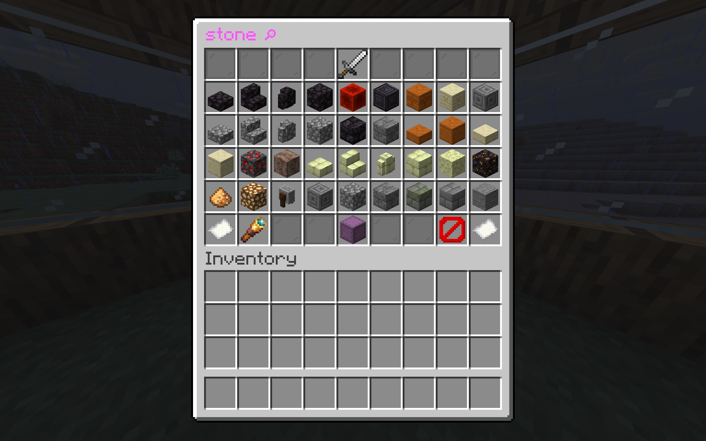

# Item Search Menu 
**[Beta]**

A 1.21.6+ paper plugin for a GUI to search for items to get. 

## Features
 - Search with dialog text input
 - GUI pagination
 - Add extra custom items like enchanted books, potions, etc to the GUI
 - Categories with icons, item filters, and minimessage names
 - Blacklist illegal items
 - Commands for configuring the blacklist, extra items, and categories
 - Brigadier based commands for enhanced tab completion
 - Target items, item tags, combined with targeting item components in both the blacklist and item filters
 - Comprehensive permissions, down to every command node
 - Customise the command to open the GUI in config.yml
 - Customisable messages which support [minimessage](https://docs.papermc.io/adventure/minimessage/format/)